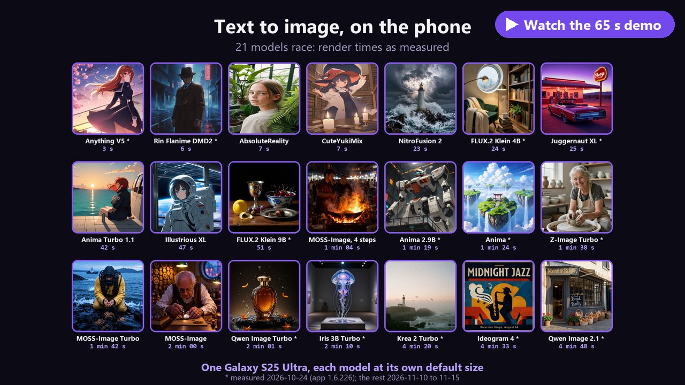
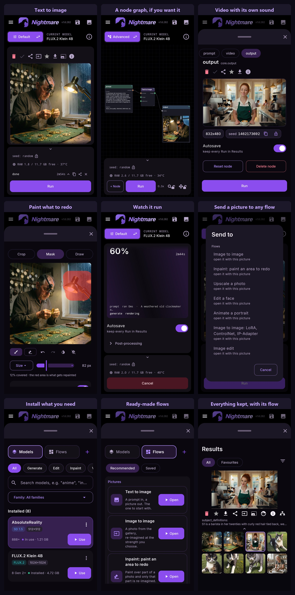

# Nightmare Mobile

**ComfyUI-style image and video generation on an Android phone, running on the Snapdragon NPU.**
FLUX.2, Z-Image, Qwen Image, SDXL, Ideogram 4, Wan 2.2 video and 51 more models, as a node graph made for
touch. No server, no account, no cloud.

**[Download the APK](https://github.com/AbrahamPaulJ/nightmare-mobile/releases/latest)** ·
**[Demo video](https://abrahampaulj.github.io/nightmare-mobile/demo/)** ·
**[Telegram group](https://t.me/nightmare_mobile)** ·
**[All releases](https://github.com/AbrahamPaulJ/nightmare-mobile/releases)** ·
**[User guide](https://abrahampaulj.github.io/nightmare-mobile/)** ·
**[Report a problem](https://github.com/AbrahamPaulJ/nightmare-mobile/issues)**

  

## Why it is worth a look

- **21 models, one phone, real times** (a Galaxy S25 Ultra, above): SD 1.5 in 3 to 7 s, SDXL at 1024x1024 in
  6 to 47 s, NitroFusion 2 and FLUX.2 Klein 4B in under 25 s, Z-Image Turbo in under 2 min, Qwen Image 2.1 and
  Ideogram 4 (readable text in pictures) in under 5.
- **Video too**: Wan 2.2 makes a 5 s clip at 832x480 in under 3 minutes, MiniMax H3 makes clips with speech,
  sound and music, and Motion transfer moves your picture the way a video you pick moves.
- **A real node graph, made for fingers**: ComfyUI's nodes and wires, with a one-step Default view when you just
  want a picture. Every result reopens as the flow that made it.
- **Your own models**: a CivitAI FLUX.2, Z-Image, Qwen Image, Krea 2, Anima or MOSS-Image fine-tune
  (`.safetensors` or GGUF) runs as it is, with no conversion. Search and download LoRAs from CivitAI and
  Hugging Face inside the app.
- **The desktop toolbox**: inpaint and outpaint, tap to select (Segment Anything), ControlNet, IP-Adapter,
  LoRAs, hires fix, Fix faces and hands (ADetailer), editing by instruction (FLUX.2 Klein, Qwen Image,
  Fibo 2.0), background removal (RMBG 3.0), upscalers, seed, setting and prompt sweeps as grids, and A1111 `parameters` in every saved PNG.
- **Offline and private**: nothing is uploaded. A local API (off by default) also speaks AUTOMATIC1111's
  `/sdapi/v1/txt2img`, so other apps can use your phone as their image generator.

  

**[Everything it does](https://abrahampaulj.github.io/nightmare-mobile/features/)**, with measurements, and the **[user guide](https://abrahampaulj.github.io/nightmare-mobile/)**, which explains each part.

## What we built

The app started from Local Dream's NPU server (SD 1.5 and SDXL) and its early DiT engine (FLUX.2 Klein and
Z-Image). The rest is Nightmare's own work, and every engine change is public in
[`backend-patches/`](backend-patches/):

- **Most of the models, brought to the phone here**: Qwen Image 2.1, Krea 2, Anima, MOSS-Image, Iris, Ideogram 4,
  FLUX.3 Klein, Fibo 2.0 Edit and Dev, FLUX.1 dev and MiniMax H3 Image, and all of the video: Wan 2.2 5B and 14B, motion transfer (Wan 2.2
  Fun Control) and MiniMax H3 with sound. Where the engine lacked a model or ran it wrong on the NPU, we ported or
  fixed it: 85 patches to stable-diffusion.cpp and ggml's Hexagon backend.
- **A 14B video model on a 12 GB phone**: Wan 2.2 14B's two experts stream from storage instead of sitting in RAM.
- **Faster NPU kernels, measured**: tensor concat about 23 times faster, a cheaper softmax and earlier prefetch
  in flash attention (a 5 s Wan clip renders 8.6 % faster from that alone), threaded copies.
- **DiT models below the flagships**: the engine runs on the 8 Gen 2 and the 8s chips, and every Snapdragon gets
  FLUX.2 Klein and NitroFusion 2 on the Adreno GPU, in pieces small enough that the screen keeps responding. On
  the 8s Gen 3 and 8s Gen 4 the NPU's matrix unit turned out to return wrong results on every model, so those
  chips run with it off.
- **Drop-in fine-tunes**: a CivitAI DiT checkpoint imports as it is; int8, fp8, ConvRot and mxfp8 files, and 16-bit
  MOSS-Image and Anima ones, become Q8_0 on the phone, and a self-made GGUF the engine cannot read is repaired on import.
- **LoRA, ControlNet and IP-Adapter chosen per render** on SD 1.5 and SDXL, on an NPU whose models are compiled
  ahead of time (the Swap models, converted with our [npuforge](https://github.com/AbrahamPaulJ/npuforge)).
- **Diagnose a wrong picture**: it renders again with each part of the NPU moved to the CPU in turn, and the
  one that comes out right names the faulty part on your chip.
- **A node graph for fingers**: a touch canvas, plugin nodes in JavaScript (QuickJS), and a scheduler that orders
  a graph with several checkpoints so each one loads once.

## What your phone needs

Android 12 or newer and a Snapdragon with a Hexagon NPU. Models are not in the APK: each one downloads when you
pick it, and the app shows which ones your phone can run.

| chip | runs, among others |
|---|---|
| Snapdragon 888 and newer | SD 1.5 |
| 8 Gen 1, 8+ Gen 1 | FLUX.2 Klein 4B and NitroFusion 2 on the GPU; Anima on the CPU (slow) |
| 8 Gen 2, 8s Gen 3, 8s Gen 4 | Z-Image Turbo, NitroFusion 2, FLUX.2 Klein 4B and 9B, Anima Turbo, Iris (much slower on the 8s chips for now) |
| 8 Gen 3 and newer | SDXL, Qwen Image 2.1, MOSS-Image, FLUX.3 Klein, Wan 2.2 video; Krea 2, Fibo 2.0 Edit and Dev, MiniMax H3 and MiniMax H3 Image with 12 GB of RAM |
| 8 Elite and newer | all of the above, plus Ideogram 4 (12 GB), FLUX.1 dev and Neodragon video |

Without a Snapdragon (MediaTek Dimensity, Exynos, Google Tensor) Text to image and Image to image still run with
an imported SDXL MNN or SD 1.5 CPU model, on the GPU or CPU. The [full table](https://abrahampaulj.github.io/nightmare-mobile/features/#what-your-phone-needs)
has every model and caveat.

## Credits

**Built on Local Dream.** The C++ inference server started as a fork of
[xororz/local-dream](https://github.com/xororz/local-dream): its QNN pipelines, model conversions,
per-chip build tiers and device gating, and the SD 1.5, SDXL and upscaler archives the app
downloads. Anyone interested in how Stable Diffusion runs on a Hexagon NPU should start
there. The DiT and video models run on [stable-diffusion.cpp](https://github.com/leejet/stable-diffusion.cpp) (leejet)
with [happyyzy's Hexagon work](https://github.com/happyyzy/stable-diffusion.cpp), on ggml. Every engine, model
and helper, with its authors and licence: **[credits](https://abrahampaulj.github.io/nightmare-mobile/credits/)** and [NOTICE](NOTICE).

## Building it

JDK 17 and Android SDK 35: `gradlew assembleDebug`. The NPU backend is a native binary that is not in
this repository; without it the app builds and the canvas works, but nothing renders. The QNN runtime
is not in the APK: the app downloads the one for the phone's NPU (QAIRT 2.51, about 28 MB) once, with
the first model, and keeps it through updates. Prompt translation needs Foxlet built once: `tools/build_foxlet.sh` (Git Bash)
clones and builds it and copies the AAR into `app/libs/`.

## Licence

**CC BY-NC 4.0**, inherited from [xororz/local-dream](https://github.com/xororz/local-dream) rather
than chosen; no further restrictions are added. Share it, fork it, build on it. Don't sell it or
ship it inside something you sell. Full text in [LICENSE](LICENSE); third-party components in
[NOTICE](NOTICE). The Qualcomm AI Runtime is under Qualcomm's own terms and is not in this repository.

## Something failed?

Tap the **share** icon on the red error message: it shows a full report with the error, the backend's
log, your phone and model files, but never your prompt. Copy or share it as a `.txt`, then attach it to an
[issue](https://github.com/AbrahamPaulJ/nightmare-mobile/issues), or ask in the [Telegram group](https://t.me/nightmare_mobile). More in the
[troubleshooting guide](https://abrahampaulj.github.io/nightmare-mobile/troubleshooting/).

## Support

[buymeacoffee.com/abrahampaulj](https://buymeacoffee.com/abrahampaulj): tips are welcome and change
nothing: the app stays free, offline and CC BY-NC, and nothing is gated behind them.

**Keywords:** on device AI, offline Stable Diffusion, ComfyUI for Android, mobile Stable
Diffusion, local image generation, on device video generation, node editor, Qualcomm Hexagon NPU,
Snapdragon, QNN, FLUX.2, Z-Image, Qwen Image, Krea 2, Iris, MOSS-Image, Ideogram 4, SDXL, Anima, Illustrious, ControlNet,
IP-Adapter, LoRA, img2img, inpainting, outpainting, Segment Anything, npuforge, image to prompt,
Danbooru tags, no cloud, private.
