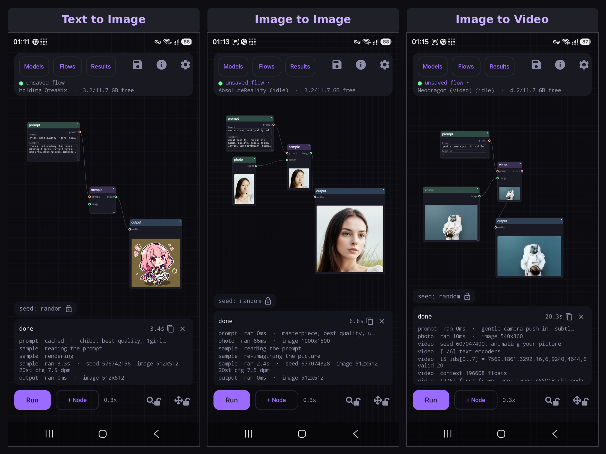

# Nightmare Mobile

**A node graph for image and video generation on Android, running on the Qualcomm Hexagon NPU.**
Text to image, image to image, inpainting, upscaling, image editing, text to video and motion transfer. All on
the phone. No server, no account, no cloud.

  

**[Download the APK](https://github.com/AbrahamPaulJ/nightmare-mobile/releases/latest)** ·
**[User guide](https://abrahampaulj.github.io/nightmare-mobile/)** ·
**[Report a problem](https://github.com/AbrahamPaulJ/nightmare-mobile/issues)**

## What your phone needs

Android 12 or newer, arm64, a Snapdragon with a Hexagon NPU. Models are not in the APK: pick one
and it downloads on first use; the app shows which ones your phone can run.

| chip | runs |
|---|---|
| Snapdragon 888 and newer | SD 1.5 |
| 8 Gen 1, 8+ Gen 1 | Anima Turbo 1.1 and Anima 2.9B on the DiT engine, run on the CPU: on testers' phones the NPU never finished a DiT step there, so a 512x512 picture takes about 15 to 20 minutes. The face editor and face animator, with a build of their own for these chips (1.6.217). SD 1.5 Swap renders no longer fail after a face edit |
| 8 Gen 2, 8s Gen 3 and newer | Z-Image Turbo and FLUX.2 Klein 4B as Q4_0 GGUFs, FLUX.2 Klein 9B, Anima Turbo 1.1 and Iris 3B Turbo on the DiT engine. On the 8s Gen 4 and 8s Gen 3 they run with the NPU's matrix unit off and decode on the CPU for now, because with it the picture comes back grey or as noise: right pictures, but much slower (minutes at 512, far longer at 1024). A model's ⋮ **Test the NPU** finds which part fails, so it can be made fast again, and every error report now says whether the matrix unit computed a test sum right when the model started. Iris 3B Turbo is not offered there: every way of running it gives noise |
| 8 Gen 3 and newer | SDXL, Anima, community-converted SDXL and SDXL Swap models; FLUX.2 Klein 4B / 9B, Qwen Image 2.1 and 2.1 Turbo, Anima Turbo 1.1 on the DiT engine, Iris 3B Turbo, MOSS-Image, Z-Image Turbo as a Q4_0 GGUF, FLUX.3 Image Klein, Fibo 2.0 Edit (12 GB), MiniMax H3 video with sound (12 GB); **alpha:** your own quantised (GGUF) DiT, Wan 2.2 video |
| 8 Elite and newer | Z-Image Turbo in FP8, SDXL Swap, Ideogram 4, Neodragon text and image to video, and all of the above |
| 8 Elite Gen 6 | SD 1.5, SDXL, Anima and the other NPU models, with the newer NPU's runtime (about 38 MB) fetched on first use (1.6.212 fixes the "Stub lib id mismatch" a tester's phone hit); the DiT models through a Gen 6 build of the engine's NPU code, the same change Local Dream made |
| 12 GB RAM | Ideogram 4 (8 Elite), Krea 2 Turbo (8 Elite and 8 Gen 3); on 12 GB it renders in parts, about 3.5 to 4 min at 1024² |

## Features

### The canvas
- **Built for a phone**: big ports, snap to connect, pinch to zoom (out to 0.15x to see a big flow whole); the picture appears on the node that made it. The run bar folds to one row (+ Node, Run, the time, the locks) for more canvas. Cancel on a run over a minute old asks first, and an Output shows its picture as soon as it is ready.
- **Local Dream's models, no second download**: models Local Dream keeps in `Download/LocalDream` are listed and run in place, never changed or deleted.
- **SDXL without the NPU**: Local Dream's SDXL CPU/GPU zips (`_mnn`) import from **+** and render on the GPU, about 17 s a step at 1024² on an 8 Elite (the CPU is about 4 times slower), for phones whose NPU cannot run SDXL. Prompts up to 231 tokens.
- **UltraFix**: Local Dream's tiled repair: redraws the detail of an upscaled picture without changing it (SD 1.5 / SDXL).
- **More options** on the Image node holds the after-render switches below, folded away; closed, it names the ones that are on. **Scheduler, seed and CFG** fold the same way, closed until you open them, showing what they are set to.
  Switching one on that needs a download (the upscaler, the face and hand detector) offers it there and then.
- **Hires fix**: one switch on the Image node: render, enlarge ×2, then UltraFix, in one Run (SD 1.5 / SDXL).
  Every other model has **Enlarge ×2** instead, so its picture can be enlarged and passed on to an inpaint that fixes faces.
- **Fix faces / Fix hands** (ADetailer): switches on the Image node. After the render the phone finds each face and
  hand (Bingsu's YOLOv8 detectors, a 25 MB Tools download) and redraws it enlarged, close up, with the same prompt, model and LoRAs (the Swap models too), its tone matched to the picture along the edge. **Detection settings** shows what is found on your last picture and sets the confidence, padding, mask blur and strength, for faces and hands apart. Switching a fix on keeps the picture you already made and redraws only its faces; a **Fix seed** with its own padlock tries another face on the same picture.
- **Edit a face** (LivePortrait): sliders for smile, eyes, gaze, mouth and a head turn, nod or tilt on the faces in any
  picture, previewed live in their own window (about a quarter of a second an edit on an 8 Elite). A **Face edit** node to wire
  after any picture, the **Edit a face** flow, and **Edit face** on a picture in Results. A 180 MB download in Models, Faces.
- **Animate a portrait** (LivePortrait): a photo of a face moving the way the face in a video you choose moves, up to
  30 seconds at 25 fps. The photo keeps its own pose and follows the video's changes. About 0.2 s a frame on an 8 Elite,
  no checkpoint involved; the same Faces download.
- **Colour**: **Match colours** on the Image node keeps an image to image, inpaint or Fix faces result in the colours of
  the picture going in; **Colour correction** and **Adjust colours** (brightness, contrast, saturation, warmth) on the Output node, after every Run or on the last picture at a tap, without rendering it again.
- **LoRA library**: sort LoRAs by name, newest, most used or size, filter by base model, star favourites, set a LoRA's model by hand when its file is not recognised, and sort them into your own folders.
- **Draw on a picture**: doodle shapes and colours over the image node's photo (or a blank page) and let image to image make them real; pinch to zoom, pick a colour from the picture or any colour from a picker.
- **Recipes**: text to image, image to image, inpaint, upscale, edit a face, image edit, text / image to video, motion transfer and two Advanced flows, grouped as Pictures, Faces, Advanced, Edit and Video, each from least to most demanding; one your phone can't run says so. Import someone's flow from the **+** beside Models and Flows.
- **Several checkpoints in one graph**: each generate node has its own model; the run loads each once and tells you the cost first.
- **Variation seed**: a second seed and a strength on SD 1.5, SDXL and Anima: small changes around a picture you like, keeping its composition.
- **Batching**: sweep seed, steps, CFG, denoise or scheduler; two at once makes a grid. Every result keeps the graph that made it.
- **Before and after**: on a flow that starts from a picture (image to image, an edit, a style change), drag the line on the output's picture to the left to see the picture you started from under it.
- **Results**: star, save, share, reopen any picture as the flow that made it; each keeps how long it took. Fold the big preview away and the grid fills the screen. In a picture's info, long-press its prompt, negative, seed or the picture itself and **Use** them on the open flow, each matched to the node you pick. A DiT picture that came out wrong on your phone (blown colours, grain, stripes) can be **Diagnosed** from the same info: it is rendered again once per part of the NPU moved to the CPU, every try kept in Results as one labelled group with a report, so the one that comes out right names what to fix on your chip.

### Models
- **49 checkpoints in the catalogue**: SD 1.5, SD 1.5 Swap, SDXL, SDXL Swap, Anima and the DiT family, each downloaded on demand. A **Community** tab under SDXL and SDXL Swap lists models converted by community members on an 8 Gen 3, so they run on the 8 Gen 3 and newer; they are hosted on their converters' own pages.
- **FLUX.2 Klein 4B / 9B, Z-Image Turbo, Qwen Image 2.1 (and its 8-step Turbo), Krea 2 Turbo, Anima Turbo 1.1, Anima 2.9B (preview)**: any size from 512 to 2048 in 64 px steps, no reload to change it.
- **MOSS-Image SFT** (8 steps): OpenMOSS's 5B model (the SFT release) with a 9B text encoder (Qwen3.5) and lodestones' 8-step speed-up applied every time. Careful, detailed pictures: about 50 s at 512x512 and under 3 min at 1024x1024 on an 8 Elite. About 10 GB. Text to image.
- **MOSS-Image Base** (8 steps): the same model before its SFT training, with lodestones' 8-step speed-up for it. It shares
  its text encoder, VAE and tokenizer with MOSS-Image SFT, so with SFT installed it is a 4.4 GB download. Text to image.
- **MOSS-Image Turbo** (8 steps): molbal's GGUF of MOSS-Image SFT with the 8-step speed-up merged in, so nothing is
  added at run time: the fastest MOSS, about 40 s at 512x512 and 2.5 min at 1024x1024 on an 8 Elite. With SFT
  installed it is a 3.3 GB download. Text to image.
- **FLUX.3 Image Klein** (16 steps): Black Forest Labs' newest model (5.6B), sharp detail, good prompt following and readable text. About 45 s at 512x512 and 2 min at 1024x1024 on an 8 Elite; also on the 8 Gen 3. About 6.2 GB, or 3.9 GB beside Krea 2 Turbo, whose text encoder it shares. Text to image, and Image edit (a photo and a prompt). FLUX Kommunity License.
- **Fibo 2.0 Edit Turbo** (4 steps): Bria's 8B editor. Wire a picture into the Image edit flow and say what to change; the rest of the picture stays, and it writes text on signs. With no picture it makes one from the prompt alone, in about a minute at 896x1600. About 8.4 GB. 8 Gen 3 or newer and 12 GB of RAM. About 1 min at 512x512 on an 8 Elite. Non-commercial.
- **Ideogram 4** (8 steps): Ideogram's 9.3B model, the best open model at readable text in a picture (signs, posters, labels), with ostris' TurboTime speed-up applied every time. About 5.5 min at 768x768 on an 8 Elite. About 11.6 GB, 12 GB phones and up. Text to image. Non-commercial use only (Ideogram's licence).
- **Iris 3B Turbo**: draws pixels directly, so there is no VAE and no decode step to run out of memory in. Only the sizes it was trained at, about 1 MP each (1024x1024, 896x1200, 896x1344, 752x1344 and the turned versions); smaller ones come out in blocks. About 2.5 min at 1024x1024 on an 8 Elite. Text to image.
- **Bring your own**: one **+** on the Models page takes any of them and works out what the file is: a converted checkpoint zip, a FLUX.2 / FLUX.3 / Z-Image / Qwen Image 2.1 / Krea 2 / Anima / MOSS-Image `.safetensors` or `.gguf` fine-tune used as it is (a 16-bit MOSS-Image `.safetensors` is made 8-bit on import, so it fits in memory, an int8 or ConvRot `.safetensors` of any of them becomes Q8_0, which the NPU runs, and a MOSS-Image import gets the built-in's 8-step speed-up, switchable from its card; a self-made GGUF that quantized the few tensors the engine cannot read that way is fixed on import), or an upscaler. Rename any import from its card. Or convert one on the phone with [npuforge](https://github.com/AbrahamPaulJ/npuforge).
- **Keep working while it downloads**: queue several downloads; meanwhile any flow that does not need the thing downloading runs, and **Use** works on the other models.
- **Upscalers**: RealESRGAN anime and 4x UltraSharp V2 Lite, or your own; the Upscale card on the output node.
- **A real inpainting model**: AbsoluteReality Inpaint sees the hole it fills.

### Editing
- **Inpaint and outpaint**: paint a mask, or zoom the frame out past the photo and the padding is generated. FLUX.2
  Klein inpaints as an edit: it edits around the mask and only the masked part is pasted back. **Draw** in the
  same window paints colours and rough shapes for the repaint to follow.
- **Tap to select**: tap an object and the mask follows its outline (Segment Anything 2.1).
- **Auto mask by name**: Clothes, Face, Hair, Shoes or Bag, found in every new photo.
- **Add Objects**: paste an object from another photo; only its edges are repainted.
- **Image editing**: FLUX.2 Klein or Qwen Image re-render a photo to follow a prompt, with up to three reference pictures (images 2 to 4), added from a References row or wired in.
- **Opening prompts written for each video model**: Text to video, Image to video, the 14B, Motion transfer, Neodragon and MiniMax H3 each open on a prompt that shows what that model does best, and switching the video model swaps it, unless you have written your own.
- **Heat**: long video renders heat the phone. The run log warns when the battery is already warm before a clip, or got hot during one, and Settings, Performance can pause a video render between steps while the battery is over 45 °C.
- **Text and image to video**: **Wan 2.2**, 5 second clips at 832×480 in under 3 minutes (any shape up to 1280×704, 1 to 5 s; Wan 2.2 5B LoRAs from the LoRA picker or a `<lora:name>` tag; **Match picture** sets the clip to the photo's shape), or **Neodragon** from the same flow's Model choice: 49 frames at 1024×640 in about 25 s on an 8 Elite. Big clips are decoded in tiles, so 704×1280 for 5 s renders on a 12 GB phone. **Seconds 0** on the video node makes one still in about 16 s. Full screen saves any frame of a clip to the gallery. **Chain** clips from the last frame and the last node hands the output **one joined film**; every part is kept in Results too, with the picture it started from.
- **Wan 2.2 14B** (image to video, and **Text to video (14B)**): the big Wan, two 14B models streamed from storage so it runs on a 12 GB phone, with lightx2v's 4-step distilled models. Text to video (14B) makes the first frame with your picture model, then animates it, so you see the picture before the clip and can keep it (lock its seed) while trying new clips. The best motion and detail, and slow: about 9 min for 2 s at 480×832 and 12 min for 1 s at 720×1280 on an 8 Elite; faces are much sharper at the larger size. Runs on an 8 Gen 3 too, up to 832×480. About 21 GB.
- **Video with sound** (MiniMax H3): a clip whose speech, sound effects and music are made together with the picture, lips in sync, from a prompt or from your photo as the first frame, and in up to 10 parts like Wan's, the sound joined with them. Its prompt opens on a worked example in the sections H3 was trained on: who is on camera and how they sound, the scene and the line they say out loud (any language), the sounds, and the music, with a hint under the box; write N/A to leave a section out. A plain one-line prompt works too, with no speech and no music. Up to 5.2 s at 384×384, 3 s at 832×480 or 640×640, 0.9 s at 768×1344; about 6 minutes for 3 s at 384×384 on an 8 Elite, 13 at 832×480. Smooth motion works on it too. 8 Gen 3 and newer with 12 GB of RAM; a 17.5 GB download (2.4 GB less beside Krea 2). Powered by MiniMax H3: its licence does not cover the European Union, the United Kingdom, South Korea or the United States, and the app asks you to accept it before the download.
- **Longer Wan clips in parts**: up to 10 parts on the Wan 2.2 Turbo and 14B nodes, each starting on the last frame of the part before, a prompt per part, joined into one video; **Keep colours** stops the slow drift darker and redder a long chain otherwise gets.
- **Smooth motion**: a switch on every Wan video node doubles the frame rate (16 to 32 fps, 24 to 48) with a new frame between every pair, made on the NPU by IFRNet. Seconds, not minutes: about 0.2 s a new frame at 480p and 0.5 s at 720p on an 8 Elite. 8 Gen 3 and newer, clips up to 1280×736 or 736×1280, a 75 MB Tools download.
- **Motion transfer** (Wan 2.2 Fun Control): your picture moving like a video you choose, by its whole-body pose (body, hands and face, DWPose) or a control video you already have. Up to 30 s, made in overlapping parts; the crop follows the person, your picture is lined up with where they start and opens the clip, and the video's sound can come along. Frame rate 24, 12 or 8 (with Smooth motion to fill in). 480×832 for 10 s on an 8 Elite: about 10 minutes at 24 fps, 5 at 12 fps with Smooth motion; a long run that is closed mid-way carries on from its last finished part.

### LoRA, ControlNet and IP-Adapter
- **LoRAs per render**: on Anima and the Swap models, and on FLUX.2, Z-Image, Qwen Image and Krea 2 (where a LoRA can make a render noticeably slower): tick, set strength (typed or slid; -2 to 2 on the DiT models), no reload. A note per LoRA keeps its trigger words.
- **Get LoRAs in the app**: search CivitAI and Hugging Face filtered to the model's family (SD 1.5, SDXL, Anima, FLUX.2 Klein, Z-Image, Qwen 2.1, Krea 2), or paste a link; hash-checked downloads.
- **SD 1.5 Swap and SDXL Swap**: npuforge conversions whose LoRA, **ControlNet** (canny, depth, openpose) and **IP-Adapter** (Plus, Face) are chosen per render; pose and depth are found from a photo on the phone.
- **Embeddings**: import a textual inversion and name it in a prompt.

### Prompts
- **A prompt from a picture**: describe any picture on the canvas or in your gallery: **Short** or **Detailed** sentences (Florence-2 PromptGen), or **Tags** in Danbooru style for anime models (WD tagger).
- **A tag toolbar**: while you type: make the tag under the cursor heavier or lighter, delete it, add one after it, undo, redo.
- **Tag autocomplete**: matching Danbooru tags under the prompt box as you type, most used first; one tap downloads the list, or import your own CSV, plus an optional translation CSV to search in your own language.
- **`<lora:name:0.8>` in a prompt**: a prompt pasted from CivitAI applies the LoRAs it names (when you have them) and the tags never reach the text encoder. Type `<lora:` and your LoRAs are offered as chips, the strength left selected to type over.
- **Samplers**: DPM++ 2M, 2M SDE, 3M and 3M SDE, Euler, Euler A and LCM with a Normal, Karras or Exponential schedule on SD 1.5 and SDXL; Euler, Heun, DPM++ 2M, ER-SDE, Res Multistep and more on the DiT models, with those three schedules plus SGM Uniform, Bong Tangent, Simple and Beta (not on Wan or Iris), so a checkpoint runs the way its author intended.
- **Translate**: a Russian or Chinese prompt to English, offline (Firefox Translations), keeping weights like `(long hair:1.2)`.

### Your phone, your files
- **English, Chinese and Russian**: the app follows your phone's language, or pick one in **Settings → Language**.
- **Themes**: follow the system, Dark, Black (AMOLED, true-black backgrounds) or Light, with a violet, blue, teal, orange or pink accent, or your wallpaper's colours on Android 12 and up.
- **Models where you can see them**: optionally in `Download/Nightmare`, surviving an uninstall.
- **Download from a mirror**: hf-mirror.com or any address, for every model the app fetches and the DiT engine (which falls back from GitHub to Hugging Face by itself); large files come over four connections at once. Tap Download on a second model while one downloads and it waits its turn. Runs carry on during a download with any model but the one downloading.
- **Your RAM back**: the model is released when you leave, and right after a run that leaves the phone short of memory (so the screen stays responsive); low-RAM switches for SDXL and Anima, and one that streams the video model for phones whose clips come out as a coloured grid.
- **A report when the phone restarts mid-run**: the next launch says what was running and how much memory was free at each step, ready to copy into a bug report.
- **Three views of one flow**: **Default** (one step at a time, the easy way in), **Advanced** (the whole flow as connected boxes) and **Chat** (hide it in Settings if you don't use it), switched from one button beside the current model (tap the model to change it); in **Default**, **Swap flow** moves to another flow for the same model keeping your prompt and settings. Models, Flows, Results and the current flow live in a sidebar; Models, Flows, Results and Settings open as sheets over the flow.
- **An agent**: ask for pictures in words: an AI model you bring your own key for (OpenRouter, OpenAI, DeepSeek, xAI, Groq or a local server) builds the flow on your canvas, finds and downloads LoRAs, uses a picture you attach, runs it and shows you the picture; no picture is ever sent to the AI model ([guide](https://abrahampaulj.github.io/nightmare-mobile/reference/agent/)).
- **A local API**: a script, desktop app or AI agent on your Wi-Fi or tailnet can run any flow; pictures and Motion transfer's video go in the request; token-protected, off by default; it also speaks the AUTOMATIC1111 WebUI API (`/sdapi/v1/txt2img`), so apps such as Layla can use your phone as their image generator; **Allow browser pages** lets a web page call it too ([guide](https://abrahampaulj.github.io/nightmare-mobile/reference/api/)).
- **Offline and private**: nothing is uploaded, no account (the optional agent talks to the provider you choose); a failure report never includes your prompt.

The [user guide](https://abrahampaulj.github.io/nightmare-mobile/) explains each of these, with measurements.

## Building it

JDK 17 and Android SDK 35: `gradlew assembleDebug`. The NPU backend is a native binary and the QNN
runtime libraries are not in this repository; without them the app builds and the canvas works, but
nothing renders. Prompt translation needs Foxlet built once: `tools/build_foxlet.sh` (Git Bash)
clones and builds it and copies the AAR into `app/libs/`.

## Credits

**The NPU work is not ours.** The C++ inference server is a fork of
[xororz/local-dream](https://github.com/xororz/local-dream): the QNN pipelines, model conversions,
per-chip build tiers and device gating come from there, as do the checkpoint and upscaler archives
the app downloads. Anyone interested in how Stable Diffusion runs on a Hexagon NPU should start
there. Every component, with its licence and terms, is listed in [NOTICE](NOTICE).

### Engines and runtimes

| project | by | licence | used for |
|---|---|---|---|
| [local-dream](https://github.com/xororz/local-dream) | xororz | CC BY-NC 4.0 | the inference server this app forks |
| [stable-diffusion.cpp](https://github.com/leejet/stable-diffusion.cpp) + [Hexagon work](https://github.com/happyyzy/stable-diffusion.cpp) | leejet, happyyzy | MIT | the DiT engine (FLUX.2, Z-Image, Qwen Image, Krea 2, Anima, Iris, MOSS-Image, Ideogram 4) |
| [ggml](https://github.com/ggml-org/ggml) | ggml authors | MIT | under stable-diffusion.cpp |
| Qualcomm AI Runtime (QNN) | Qualcomm | Qualcomm's terms | the NPU; not in this repository |
| [MNN](https://github.com/alibaba/MNN) | Alibaba | Apache 2.0 | CPU and GPU model paths |
| [ONNX Runtime](https://github.com/microsoft/onnxruntime) | Microsoft | MIT | the picture helpers below |
| [QuickJS](https://bellard.org/quickjs/) | Fabrice Bellard, Charlie Gordon | MIT | plugin nodes |
| [Foxlet](https://github.com/yinvoke/foxlet-translate) (Bergamot, Marian) | yinvoke; Mozilla; Marian authors | MIT; MPL-2.0; MIT | prompt translation |
| [Inter](https://github.com/rsms/inter) | Rasmus Andersson | SIL OFL 1.1 | the typeface |

### Image and video models

| model | by | licence | notes |
|---|---|---|---|
| [FLUX.2 klein 4B](https://huggingface.co/black-forest-labs/FLUX.2-klein-4b-fp8) | Black Forest Labs | Apache 2.0 | [leejet's GGUF](https://huggingface.co/leejet/FLUX.2-klein-4B-GGUF) on 8 Gen 3; text encoder and VAEs converted by [zhiyuanasad](https://huggingface.co/zhiyuanasad/flux2_klein_adreno) |
| [FLUX.2 klein 9B](https://huggingface.co/black-forest-labs/FLUX.2-klein-9B) | Black Forest Labs | FLUX Non-Commercial | [leejet's GGUF](https://huggingface.co/leejet/FLUX.2-klein-9B-GGUF); [Qwen3-8B](https://huggingface.co/Qwen/Qwen3-8B) encoder (Apache 2.0, [bartowski's GGUF](https://huggingface.co/bartowski/Qwen_Qwen3-8B-GGUF)) |
| [Z-Image Turbo](https://huggingface.co/Tongyi-MAI/Z-Image-Turbo) | Tongyi-MAI | Apache 2.0 | fp8 weights by [Kijai](https://huggingface.co/Kijai/Z-Image_comfy_fp8_scaled); [leejet's GGUF](https://huggingface.co/leejet/Z-Image-Turbo-GGUF) on 8 Gen 3 |
| [Qwen Image 2.1](https://huggingface.co/Qwen/Qwen-Image-2.1) and [2.1 Turbo](https://huggingface.co/Qwen/Qwen-Image-2.1-Turbo) | Qwen team | Qwen Research License | [leejet's GGUF](https://huggingface.co/leejet/Qwen-Image-2.1-GGUF) / [unsloth's FP8](https://huggingface.co/unsloth/Qwen-Image-2.1-FP8); Turbo: [molbal's GGUF](https://huggingface.co/molbal/Qwen-Image-2.1-Turbo-GGUF); VAE by [Comfy-Org](https://huggingface.co/Comfy-Org/Qwen-Image-2.1); [Qwen3-VL-8B](https://huggingface.co/Qwen/Qwen3-VL-8B-Instruct) encoder (Apache 2.0, [bartowski](https://huggingface.co/bartowski/Qwen_Qwen3-VL-8B-Instruct-GGUF)) |
| [Krea 2 Turbo](https://huggingface.co/krea/Krea-2-Turbo) | Krea | [Krea 2 Community License](https://krea.ai/krea-2-licensing) | [gguf-org MXFP4 GGUF](https://huggingface.co/gguf-org/krea-2-gguf); [Qwen3-VL-4B](https://huggingface.co/Qwen/Qwen3-VL-4B-Instruct) encoder (Apache 2.0, [bartowski](https://huggingface.co/bartowski/Qwen_Qwen3-VL-4B-Instruct-GGUF)); [Wan 2.1 VAE](https://huggingface.co/Comfy-Org/Wan_2.1_ComfyUI_repackaged) (Apache 2.0) |
| [MOSS-Image](https://huggingface.co/OpenMOSS-Team/MOSS-Image-SFT) ([Base](https://huggingface.co/OpenMOSS-Team/MOSS-Image-Base)) | OpenMOSS | Apache 2.0 | the SFT and Base DiTs as our Q4_0 ([nightmare-moss-image](https://huggingface.co/AbrahamPJ/nightmare-moss-image), from [realrebelai's GGUF](https://huggingface.co/realrebelai/MOSS-Image_GGUFs)); Turbo: [molbal's GGUF](https://civitai.com/models/3009877) with the SFT LoRA merged in, re-hosted as its permissions allow; 8-step DMD LoRAs for [SFT](https://huggingface.co/lodestones/MOSS-Image-SFT-8-steps-dmd) and [Base](https://huggingface.co/lodestones/MOSS-Image-Base-8-steps-dmd) (lodestones, Apache 2.0); [Qwen3.5 9B](https://huggingface.co/unsloth/Qwen3.5-9B-GGUF) encoder (Apache 2.0); FLUX.2 VAE |
| [Ideogram 4](https://huggingface.co/ideogram-ai/ideogram-4-fp8) | Ideogram | Ideogram Non-Commercial Model Agreement | [leejet's Q4_0 GGUF](https://huggingface.co/leejet/ideogram-4-GGUF); [Qwen3-VL-8B](https://huggingface.co/Qwen/Qwen3-VL-8B-Instruct) encoder (Apache 2.0, [unsloth](https://huggingface.co/unsloth/Qwen3-VL-8B-Instruct-GGUF)); [TurboTime LoRA](https://huggingface.co/ostris/ideogram_4_turbotime_lora) by ostris, applied every time; the FLUX.2 VAE |
| [FLUX.3 Image Klein](https://huggingface.co/black-forest-labs/flux-3-image-klein) | Black Forest Labs | FLUX Kommunity License | [leejet's Q4_0 GGUF](https://huggingface.co/leejet/flux-3-image-klein-GGUF); Krea 2's [Qwen3-VL-4B](https://huggingface.co/Qwen/Qwen3-VL-4B-Instruct) encoder (Apache 2.0); the FLUX.2 VAE; run through a backport of [stable-diffusion.cpp's FLUX.3 support](https://github.com/leejet/stable-diffusion.cpp/pull/2143) |
| [Fibo 2.0 Edit Turbo](https://huggingface.co/briaai/Fibo-2.0-edit-turbo) | Bria AI | non-commercial (CC BY-NC 4.0 and Bria's terms) | [our all-Q4_0 GGUF](https://huggingface.co/AbrahamPJ/fibo2-edit-turbo-q4_0-gguf), made from [realrebelai's](https://huggingface.co/realrebelai/Fibo-2.0_GGUFs); [Qwen3-VL-4B](https://huggingface.co/Qwen/Qwen3-VL-4B-Instruct) and its vision tower (Apache 2.0); the FLUX.2 VAE; run through a backport of [stable-diffusion.cpp's Fibo 2.0 support](https://github.com/leejet/stable-diffusion.cpp/pull/2180) |
| [Iris 3B Turbo](https://huggingface.co/speridlabs/iris-3b) | speridlabs | Apache 2.0 | the official BF16, converted to GGUF on the phone; [Qwen3-VL-4B](https://huggingface.co/Qwen/Qwen3-VL-4B-Instruct) encoder (Apache 2.0, [bartowski](https://huggingface.co/bartowski/Qwen_Qwen3-VL-4B-Instruct-GGUF)) |
| [Wan 2.2 I2V A14B](https://huggingface.co/Wan-AI/Wan2.2-I2V-A14B) | Wan team (Alibaba) | Apache 2.0 | image to video; [lightx2v's 4-step distilled models](https://huggingface.co/lightx2v/Wan2.2-Distill-Models) (Apache 2.0) as [jayn7's Q4_0 GGUFs](https://huggingface.co/jayn7/WAN2.2-I2V_A14B-DISTILL-LIGHTX2V-4STEP-GGUF); Wan 2.2 Turbo's encoder; TAEHV's Wan 2.1 decoder |
| [IFRNet](https://github.com/ltkong218/IFRNet) | Lingtong Kong et al. | MIT | smooth motion; IFRNet-S with its GoPro weights, converted for the NPU |
| [Wan 2.2 Fun 5B Control](https://huggingface.co/alibaba-pai/Wan2.2-Fun-5B-Control) | alibaba-pai | Apache 2.0 | motion transfer; [QuantStack's Q4_0 GGUF](https://huggingface.co/QuantStack/Wan2.2-Fun-5B-Control-GGUF) (Apache 2.0); 3 steps with [FastVideo](https://huggingface.co/FastVideo/FastWan2.2-TI2V-5B-FullAttn-Diffusers)'s FastWan (Apache 2.0) as [Kijai's LoRA](https://huggingface.co/Kijai/WanVideo_comfy); Wan 2.2 Turbo's encoder and decoder |
| [MiniMax H3](https://huggingface.co/MiniMaxAI/MiniMax-H3) | MiniMax | [MiniMax H3 Community License](https://huggingface.co/MiniMaxAI/MiniMax-H3/blob/main/LICENSE) (not the EU, the UK, South Korea or the US) | video with sound; FastVideo's [FastH3 4-step Preview](https://huggingface.co/FastVideo/FastVideo-FastH3-4-step-Preview-v1-Dense-DataFree) as [our Q4_0 GGUF](https://huggingface.co/AbrahamPJ/fasth3-dense-v1-q4_0-gguf), requantized from [Gestura's](https://huggingface.co/ZawShiShawn/Gestura-FastH3-GGUF); Gestura's [Q8_0 video VAE](https://huggingface.co/ZawShiShawn/Gestura-MiniMax-H3-VAE-GGUF); [Comfy-Org's](https://huggingface.co/Comfy-Org/MiniMax-H3) audio VAE; Krea 2's [Qwen3-VL-4B](https://huggingface.co/Qwen/Qwen3-VL-4B-Instruct) encoder (Apache 2.0) through NicoLab28's [ClipProj](https://huggingface.co/NicoLab28/ClipProj-MiniMax-H3) (MIT) in place of H3's 32B encoder |
| [Neodragon](https://huggingface.co/Qualcomm-AI-Research/Neodragon) | Qualcomm AI Research | BSD-3-Clause-Clear + model card terms | text and image to video, converted for the NPU |
| [SSD-1B](https://huggingface.co/segmind/SSD-1B) | Segmind | Apache 2.0 | the video's first frame |
| [Wan 2.2 TI2V 5B](https://huggingface.co/Wan-AI/Wan2.2-TI2V-5B) Turbo | Wan team (Alibaba); [Turbo](https://github.com/quanhaol/Wan2.2-TI2V-5B-Turbo) by quanhaol | Apache 2.0 (Wan 2.2); the Turbo code is CC BY-NC-SA 4.0 and its weights state none | [hum-ma's Q4_0 GGUF](https://huggingface.co/hum-ma/Wan2.2-TI2V-5B-Turbo-GGUF) (Apache 2.0); [umT5-XXL](https://huggingface.co/google/umt5-xxl) encoder (Apache 2.0, [city96's GGUF](https://huggingface.co/city96/umt5-xxl-encoder-gguf)); [TAEHV](https://github.com/madebyollin/taehv) decoder by madebyollin (MIT) |
| [Anima Turbo 1.1](https://huggingface.co/circlestone-labs/Anima) | CircleStone Labs, built on NVIDIA Cosmos | [CircleStone Labs Non-Commercial License](https://huggingface.co/circlestone-labs/Anima/blob/main/LICENSE.md) and the [NVIDIA Open Model License](https://www.nvidia.com/en-us/agreements/enterprise-software/nvidia-open-model-license/) | downloaded as published and converted to Q8_0 on the phone; [Qwen3-0.6B-Base](https://huggingface.co/Qwen/Qwen3-0.6B-Base) encoder (Apache 2.0, [mradermacher GGUF](https://huggingface.co/mradermacher/Qwen3-0.6B-Base-GGUF)); Qwen-Image VAE (Apache 2.0) |
| [Anima 2.9B (preview)](https://huggingface.co/Gazingstars123/Anima-2.9B) | Gazingstars123, a depth expansion of CircleStone Labs' Anima | [CircleStone Labs Non-Commercial License](https://huggingface.co/circlestone-labs/Anima/blob/main/LICENSE.md) (derivative model) | downloaded as published and converted to Q8_0 on the phone; Anima Turbo's encoder and VAE |
| [Anima 2.9B Turbo LoRA](https://civitai.com/models/2857451/anima-29b-turbo-lora-remapped) | Karely_ai | CivitAI permissions: re-hosting, derivatives and commercial use allowed, no credit required | re-hosted unchanged at [AbrahamPJ/nightmare-anima-turbo-lora](https://huggingface.co/AbrahamPJ/nightmare-anima-turbo-lora); on every Anima 2.9B render |
| SD 1.5, SDXL, Anima catalogue and upscalers | their authors, converted by xororz | each model's licence | via local-dream |
| AbsoluteReality v1.8.1 / Inpaint, CuteYukiMix, Anything V5 | Lykon, kemiaomiao, Yuno779 | CreativeML OpenRAIL-M | SD 1.5 Swap defaults, [our conversions](https://huggingface.co/AbrahamPJ/nightmare-sd15-swap-models) |
| Illustrious XL v1.0, Juggernaut XL Ragnarok | OnomaAI Research, RunDiffusion | OpenRAIL++-M; OpenRAIL-M + RunDiffusion's terms | SDXL Swap defaults, [our conversions](https://huggingface.co/AbrahamPJ/nightmare-sdxl-swap-models) |
| Community SDXL and SDXL Swap conversions | their authors, converted with npuforge by community members | each model's licence | the Community tab, downloaded from their converters' pages |

### Control, reference and picture helpers

| model | by | licence | used for |
|---|---|---|---|
| [ControlNet 1.1](https://huggingface.co/lllyasviel/ControlNet-v1-1) (canny, depth, openpose) | lllyasviel | CreativeML OpenRAIL-M | SD 1.5 Swap, [our QNN builds](https://huggingface.co/AbrahamPJ/nightmare-sd15-controlnet-qnn) |
| SDXL ControlNets: [canny](https://huggingface.co/diffusers/controlnet-canny-sdxl-1.0), [depth](https://huggingface.co/diffusers/controlnet-depth-sdxl-1.0), [openpose](https://huggingface.co/thibaud/controlnet-openpose-sdxl-1.0) | diffusers team; Thibaud Zamora | OpenRAIL++-M; openpose: CMU non-commercial | SDXL Swap, [our QNN builds](https://huggingface.co/AbrahamPJ/nightmare-sdxl-controlnet-qnn) |
| [IP-Adapter Plus / Plus Face](https://huggingface.co/h94/IP-Adapter) + OpenCLIP ViT-H/14 | Tencent AI Lab; OpenCLIP (LAION-2B) | Apache 2.0; MIT | reference pictures, [as ONNX](https://huggingface.co/AbrahamPJ/nightmare-ip-adapter) |
| [MoveNet MultiPose Lightning](https://huggingface.co/Xenova/movenet-multipose-lightning) | Google | Apache 2.0 | pose from a photo (with local-dream's OpenPose renderer); finds the person Motion transfer follows |
| [DWPose](https://huggingface.co/yzd-v/DWPose) (RTMPose-L wholebody) | IDEA Research (Yang et al.) | Apache 2.0 | Motion transfer's whole-body pose |
| [ADetailer face and hand detectors](https://huggingface.co/Bingsu/adetailer) | Bingsu (Ultralytics YOLOv8), ONNX export mirrored at [AbrahamPJ/nightmare-adetailer](https://huggingface.co/AbrahamPJ/nightmare-adetailer) | Apache 2.0 | Fix faces, Fix hands |
| [LivePortrait](https://github.com/KwaiVGI/LivePortrait) with YOLOFace and 2DFAN4 | Kuaishou; NPU builds by [facefusion-mobile](https://huggingface.co/AbrahamPJ/facefusion-mobile-models) | MIT | Face edit |
| [Depth Anything V2 Small](https://huggingface.co/onnx-community/depth-anything-v2-small) | Depth Anything team | Apache 2.0 | depth from a photo |
| [SAM 2.1](https://github.com/facebookresearch/sam2) hiera-tiny | Meta | Apache 2.0 | tap to select |
| [SegFormer-B2 on ATR](https://huggingface.co/mattmdjaga/segformer_b2_clothes) | mattmdjaga | MIT | auto mask by name |
| [Florence-2 PromptGen v2.0](https://huggingface.co/MiaoshouAI/Florence-2-base-PromptGen-v2.0) | MiaoshouAI, on Microsoft's [Florence-2](https://huggingface.co/microsoft/Florence-2-base-ft) | MIT | describe: sentences, [as ONNX](https://huggingface.co/AbrahamPJ/florence2-promptgen-onnx) on onnx-community's graphs |
| [WD ViT tagger v3](https://huggingface.co/SmilingWolf/wd-vit-tagger-v3) | SmilingWolf | Apache 2.0 | describe: tags |
| [Firefox Translations](https://github.com/mozilla/firefox-translations-models) (ru, zh → en) | Mozilla | MPL-2.0 | prompt translation |
| [T5 tokenizer](https://huggingface.co/google-t5/t5-base) (`tokenizer.json`) | Google | Apache 2.0 | counting Anima prompt tokens (n/512) |
| [Danbooru tag list](https://github.com/DominikDoom/a1111-sd-webui-tagcomplete) (`danbooru.csv`) | Dominik Reh (a1111-sd-webui-tagcomplete) | MIT | tag autocomplete, [hosted here](https://huggingface.co/AbrahamPJ/nightmare-tags) |

## Licence

**CC BY-NC 4.0**, inherited from [xororz/local-dream](https://github.com/xororz/local-dream) rather
than chosen; no further restrictions are added. Share it, fork it, build on it. Don't sell it or
ship it inside something you sell. Full text in [LICENSE](LICENSE); third-party components in
[NOTICE](NOTICE). The Qualcomm AI Runtime is under Qualcomm's own terms and is not in this repository.

## Something failed?

Tap the **share** icon on the red error message: it shows a full report with the error, the backend's
log, your phone and model files, but never your prompt. Copy or share it as a `.txt`, then attach it to an
[issue](https://github.com/AbrahamPaulJ/nightmare-mobile/issues). More in the
[troubleshooting guide](https://abrahampaulj.github.io/nightmare-mobile/troubleshooting/).

## Support

[buymeacoffee.com/abrahampaulj](https://buymeacoffee.com/abrahampaulj): tips are welcome and change
nothing: the app stays free, offline and CC BY-NC, and nothing is gated behind them.

**Keywords:** on device AI, offline Stable Diffusion, ComfyUI for Android, mobile Stable
Diffusion, local image generation, on device video generation, node editor, Qualcomm Hexagon NPU,
Snapdragon, QNN, FLUX.2, Z-Image, Qwen Image, Krea 2, Iris, MOSS-Image, Ideogram 4, SDXL, Anima, Illustrious, ControlNet,
IP-Adapter, LoRA, img2img, inpainting, outpainting, Segment Anything, npuforge, image to prompt,
Danbooru tags, no cloud, private.
