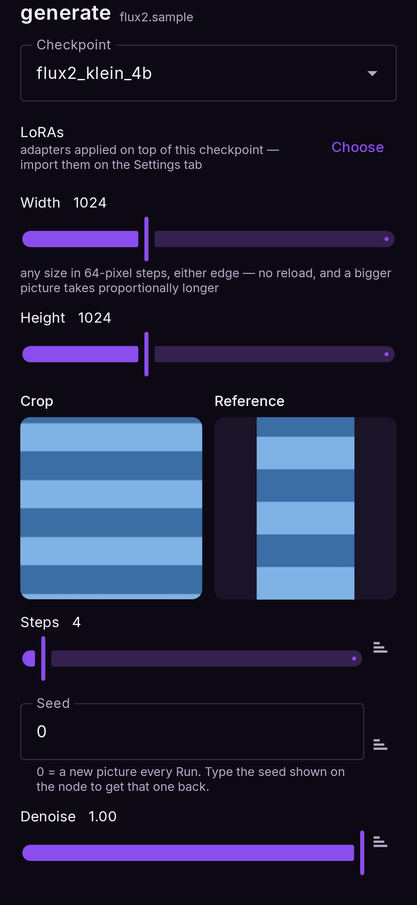

# Image edit

*A photo and a prompt: the whole picture is re-rendered to follow it, rather than nudged.*

**Nodes:** Prompt and Image → Image edit → Output. **Needs a Snapdragon 8 Gen 3 or newer** and
one of the edit models: **FLUX.2 Klein** (4B or 9B), **FLUX.3 Klein**, **Qwen Image 2.1** or **Fibo 2.0 Edit**.
FLUX.3 Klein follows direct changes best ("Change the text on the sign to say Fibo, and make the scarf blue");
for a change to the whole scene ("make it winter"), use Fibo 2.0 Edit.

Where [Image to image](image-to-image.md) repaints a photo loosely, an edit model reads the
photo as a reference and follows an **instruction**: the composition survives, the content
changes. *Make it winter*, *turn the car red*, *put a hat on the dog*.

## Steps

1. Install **FLUX.2 Klein**, **FLUX.3 Klein**, **Qwen Image 2.1** or **Fibo 2.0 Edit** under Models (see below for which).
2. **Flows → Image edit.** With Qwen selected in Models, it opens as a Qwen edit; otherwise as
   FLUX.2.
3. Tap the **image** node and choose the photo.
4. Write the instruction in the **prompt**: `make it a snowy winter evening`.
5. **Run.**

To change only one part of the picture with FLUX.2, open the **Image** node's page (Default view) and choose **Swap flow →
Inpaint**: the same picture opens with a **Mask** to paint. Klein then edits around the mask and only the
masked part is pasted back, so the rest stays exactly as it was ([Inpaint](inpaint.md)).

## FLUX.2 or Qwen?

| | FLUX.2 Klein 4B | Qwen Image 2.1 |
|---|---|---|
| Download | 6.7 GB | 10.8 GB (13.8 GB FP8 on a 16 GB phone) |
| Speed (edit, 8 Elite) | about a minute at 512 | about 14 minutes at 1024 (Turbo: about 8) |
| Strength | Fast, good at style and scene changes | Follows long instructions; reads the photo with a vision model; can write legible text |
| Best size | **512 × 512** with a reference (see below) | smaller sizes are much faster |

Start with FLUX.2. Reach for Qwen when FLUX.2 does not understand what you asked.

## More pictures: references

Up to **four pictures** can go into one edit: the base photo is **image 1** and up to three
references are **image 2, 3 and 4**. Name them in the prompt:
`put the jacket from image 2 and the hat from image 3 on the person in image 1`.

- **Default view:** the edit page has a **References** row. Tap **+** to add a picture, tap a
  thumbnail to replace it, and its **x** to remove it (the ones after it move up a number). The
  **+** is dimmed, and says why when tapped, once there are four pictures or when this phone does
  not have the memory for another at the current size.
- **Advanced view:** the node has a **reference** input; wiring a picture into it shows a
  **reference 3** input, and that one shows **reference 4**.

Each reference makes the edit slower and needs more memory, so add only the ones you need.

<figure markdown>
  { .screen }
</figure>

You can also wire **only** a reference and no base photo: *generate something new, guided by
this picture*.

!!! warning "Keep FLUX.2 at 512 with a reference"
    With FLUX.2, a reference is processed at your **output** size, not its own. On a 12 GB
    phone a 1024 × 1024 edit with a reference runs out of memory; 512 × 512 finishes in about
    a minute. The Reference tab warns you when the size is too big. For Qwen, reference editing
    is new. Please report how it goes.

    On a Snapdragon 8 Gen 3, a reference is read at about half a megapixel (around 724 × 724)
    whatever the output size, so a 1024 × 1024 output fits; the output keeps its size. Where a
    size was measured not to fit (Klein 9B, Qwen 2.1), the run log says so before rendering and
    names a size that does.

## Denoise and padding

- An edit starts at **denoise 1.0**: the full schedule runs and the photo guides it as a clean
  reference. Lower values start from the photo itself and change less.
- **Allow padding** in the crop window lets the frame zoom out past the photo; the empty part
  is filled with the **Pad** choice (black, blur, or green for an outpaint LoRA) and generated.
