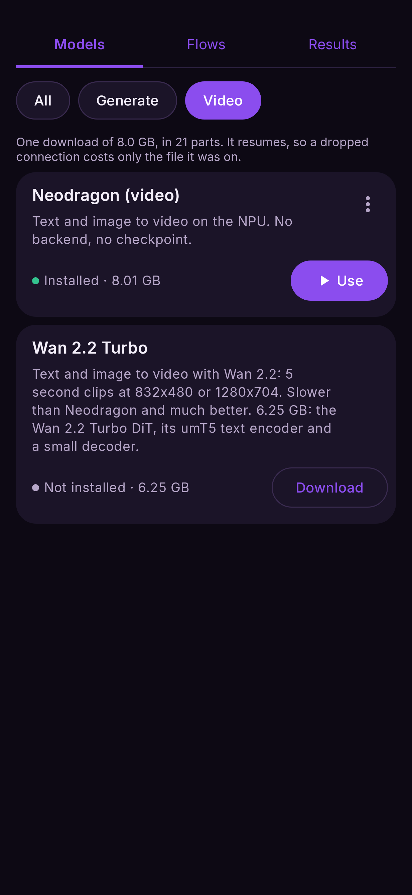

# Video

*A prompt, or a prompt and a photo, into a clip. Or your photo moving like a video you choose.*

There are three video models. Install any of them:

| model | makes | needs |
|---|---|---|
| **Wan 2.2 Turbo** (6.25 GB) | up to 5 seconds, any shape up to 1280 × 704. The better clips; minutes per clip | Snapdragon 8 Elite or newer (alpha on 8 Gen 3: tell us if it runs) |
| **Wan 2.2 14B** (about 21 GB; 3.7 GB less beside Wan 2.2 Turbo) | your picture moving, or text to video through a picture first (**Text to video (14B)** below). The best motion and detail, and slow: about 9 minutes for 2 seconds at 480 × 832, 12 minutes for 1 second at 720 × 1280 (faces come out much sharper at the larger size) | Snapdragon 8 Elite or newer, 12 GB of RAM |
| **Neodragon** (about 8.6 GB) | 2 seconds at 1024 × 640 in about 25 seconds | Snapdragon 8 Elite or 8 Elite Gen 5 |

Video has its own models; only **Text to video (14B)** also uses your picture model, for its first frame. **Models → Video** lists them all, and **Wan**
in the family menu has Wan's models on their own page.

## Text to video

**Nodes:** Prompt → Video → Output.

1. **Flows → Text to video.**
2. Write the prompt: describe the scene *and the motion*. `waves rolling onto a beach at
   sunset, camera slowly panning right`.
3. **Run.** With Wan 2.2, 5 seconds at 832 × 480 takes under **3 minutes** (about 2:45) on an 8 Elite; the
   bar moves once per step, four steps, then the clip is decoded and encoded.

The video node's **Model** dropdown switches between **Wan 2.2 Turbo** (the default) and **Neodragon** (the fastest), and **Wan 2.2 14B** with a picture wired: the 14B animates a picture. For text to video on the 14B, use the next flow.
**Use** on Neodragon in Models opens the flow on Neodragon.

## Text to video (14B)

**Nodes:** Prompt → Image (your picture model) → Video (Wan 2.2 14B) → Output. Needs Wan 2.2 14B and an 8 Elite or newer with 12 GB.

1. **Flows → Text to video (14B)**. The picture is made by the model in the top bar, in its own shape: the clip takes
   that shape (a 512 × 768 picture makes a portrait clip), and the video node's size sets how many pixels, 832 × 480
   worth for a quick try or 1280 × 720 worth for sharp faces. 1 second by default.
2. Write one prompt for the scene and its motion: it makes the picture and drives the clip.
3. **Run.** The picture appears on its node first, in seconds, then the clip takes minutes. Not the picture you wanted? Stop the run and Run again. Happy with it? Lock its seed (the seed chip lists each node's seed): the next Run keeps that picture and only makes a new clip.

The clip **loops on the node** that made it; tap it to play it full screen. With **Save** on
(the default), an MP4 is also written to `Movies/Nightmare`.

## Image to video

**Nodes:** Prompt and Image → Video → Output, the same flow with a photo wired in.

1. **Flows → Image to video.**
2. Choose the photo on the **image** node. Tap the video node's **Crop** preview: the frame
   takes the clip's shape; drag and pinch to choose the part that is animated. The photo is the
   clip's **first frame**.
3. Describe what moves: `the camera slowly pushes in, the woman turns her head and smiles`.
   **Run.**

## Wan 2.2 settings

| setting | does |
|---|---|
| **Width**, **Height** | Any shape, in 32 px steps, up to 1280 × 704 worth of pixels: square, 4:3, 21:9, a phone screen. Past that, the other side shrinks to fit. Wan 2.2 is made for 1280 × 704: smaller sizes, 832 × 480 included, can look soft or distorted. 832 × 480 is quickest; 1280 × 704 takes about three times as long. On **Wan 2.2 14B** (its own 16 px steps, up to 1280 × 720 worth of pixels), 1280 × 720 is the size for faces and fine detail (about 12 minutes for 1 second); 832 × 480 is for trying an idea first (about 5 minutes), with soft faces. **Match picture** sets the photo's shape |
| **Seed** | `0` = a new clip every Run; type a seed shown on the node to get that clip back |
| **Seconds** | 0 to 5, at 24 frames a second (Wan 2.2 14B: 1 to 5 at 16 frames a second); 0 makes one still picture (about 15 s at 832 × 480 on an 8 Elite; wire **last frame** to the output). On a 12 GB phone, 1280 × 704 for 3 seconds or more renders in parts so it fits: slower, about 12 minutes for 5 seconds. On an 8 Gen 3 a new flow opens on 2 seconds, the longest that has worked there so far; longer clips and 1280 × 704 still run, with a warning in the run log |
| **LoRAs** | Wan 2.2 Turbo (TI2V-5B) LoRAs only; Wan 2.2 14B takes none (its speed-up is built in). See [LoRAs](../models/loras.md) |

Neodragon has **Seed** and **Upscale** (on: 2× to 1024 × 640; off: 512 × 320, a little faster).

<figure markdown>
  { .screen }
</figure>

## Longer clips: one film

The Wan video node has a second output, **last frame**: the clip's final frame as a picture. In
advanced view, wire it into another Wan video node's **image** and give that one its own prompt:
it carries on from where the first clip ended.

The second node's **video** is then the **whole film so far**, the first clip and its own joined
into one (the frame they share appears once). Chain as many as you like: the last node hands the
Output the complete film. **Results** keeps every part on its own as well, each with the picture
it started from, grouped together beside the film.

On the canvas, a film longer than about 5 seconds loops faster than real time; full screen plays
it at its own speed. The **camera** button beside share (full screen, on the canvas and in
Results) saves the frame on screen to the gallery as a picture.

## Motion transfer

*Your picture moving like a video you choose: its pose, frame by frame.*

**Needs** Wan 2.2 Fun Control: about 3.7 GB with Wan 2.2 Turbo installed (it borrows Turbo's text
encoder and decoder), 7.3 GB without. **Models → Video → Wan 2.2 Fun Control → Download.**

**Nodes:** Prompt, Image (who moves) and **Video** (the moving clip) → Motion transfer → Output.

1. **Flows → Motion transfer.**
2. Choose your picture on the **image** node: it is who the clip shows (face, clothes, setting).
3. Choose a video on the **Video** node: a person dancing, walking, waving.
4. On the Motion transfer node, tap the **Video** preview:
    - **Part of the video**: drag either end. The part you choose is the clip's length, up to
      5 seconds, shown as seconds and frames.
    - **The box**: drawn on that part's first frame, at the clip's shape. Every frame is cut the
      same way, so keep the person inside it.
5. Pick a **Mode** (the ⓘ beside it says which to use) and **Run**.

| Mode | for |
|---|---|
| **Pose** | a real video of a person. The pose is read from every frame and your picture copies it. Body only: hands and face are not followed. Needs the Pose Detector (Models, Tools) |
| **As is** | a video that already is a control video: a pose skeleton or a depth map made elsewhere. An ordinary video here will not work well |

Motion transfer takes no LoRAs: `<lora:…>` tags in its prompt are skipped, and the run log says
so. 480p is quickest; at 704 × 1280 faces hold better and a clip takes about three times as long.
