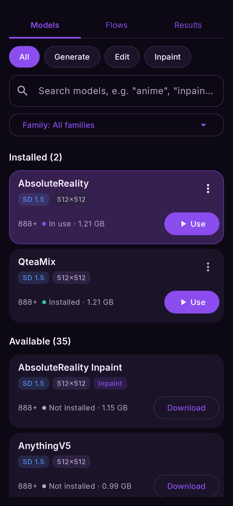

# Models

A **model** (or **checkpoint**) is the trained network that actually draws. Nightmare ships
without any. You download the ones you want from **Models**, and each is downloaded once and
kept.

Models come in **families**. A family decides how prompts are written, what sizes it draws and
which phones can run it; inside a family, models differ in style.

## The families

| family | models | size each | draws | style | needs |
|---|---|---|---|---|---|
| **SD 1.5** | 6 | ~1 GB | 512–1024 | Fast; realistic, anime and general mixes | Snapdragon 888+ |
| **SD 1.5 Swap** *(experimental)* | AbsoluteReality, CuteYukiMix, Anything V5, or your own npuforge conversion | ~1.3 GB | 512 | LoRAs, ControlNet (canny, depth, openpose) and an IP-Adapter reference picture chosen per render | defaults: 8 Elite+; your own conversion: the phone that made it |
| **SDXL** | 10, and 2 in **Community** (8 steps, DMD2 merged) | ~3.5 GB | 1024 | Sharper, better composition | 8 Gen 3+ |
| **SDXL Swap** | Illustrious XL, Juggernaut XL, 2 in **Community**, or your own npuforge conversion | ~3.9 GB | 1024 | LoRAs, ControlNet (canny, depth, openpose) and an IP-Adapter reference picture chosen per render | defaults: 8 Elite+; Community: 8 Gen 3+; your own conversion: the phone that made it |
| **Anima** | 9 | ~4.3 GB | 1024 | Anime; slow (about 80 s a picture) | 8 Gen 3+ |
| **FLUX.2** | Klein 4B, Klein 9B | 6.7 GB, 10.7 GB | 512–2048 | Understands sentences; edits photos. 9B: more detail, slower, starts at 768 | 8 Gen 3+ (alpha on 8 Gen 3, where the 4B is a Q8_0 GGUF: 6.9 GB in all); the 9B also on 8 Gen 2 (alpha) |
| **Z-Image** | Turbo | 8.8 GB | 512–2048 | Photorealistic, fast for its size | 8 Gen 2+ (alpha on 8 Gen 2 and 8 Gen 3, where it is a Q4_0 GGUF: 6.3 GB in all) |
| **Qwen Image** | 2.1, 2.1 Turbo | 10.8 GB (16 GB phone: 13.8 GB FP8); Turbo 10.8 GB | 512–2048 | Follows long instructions, legible text; edits photos; slow. Turbo: 8 steps, about 2.5 times faster | 8 Gen 3+ (alpha on 8 Gen 3, which always takes the 10.8 GB build) |
| **Anima DiT** | Turbo 1.1 | 3.2 GB (4.2 GB download, converted on the phone) | 512–2048 | Anime; about a minute at 1024 | 8 Gen 1+ (alpha on 8 Gen 1, 8 Gen 2 and 8 Gen 3; on the 8 Gen 1 it runs on the CPU, about 15 to 20 minutes at 512) |
| **Anima DiT** | 2.9B (preview) | 4.2 GB (6.8 GB download, converted on the phone) | 512–2048 | Anime, a larger model with a built-in turbo LoRA: 8 steps at CFG 1, about 95 s at 1024 on an 8 Elite | 8 Gen 1+ (alpha) |
| **Krea 2** | Turbo | 9.5 GB | 512–2048 | Text to image only. On a 12 GB phone it renders in parts: about 3.5 to 4 min at 1024 | 12 GB RAM, and 8 Elite+ (alpha on 8 Gen 3) |
| **MOSS-Image** | SFT, Base and Turbo, 8 steps | about 10 GB (Base 4.4 GB, Turbo 3.3 GB more beside SFT) | 512–2048 | Text to image only. Careful and detailed, with an 8-step speed-up applied every time: about 50 s at 512 and under 3 min at 1024 | 8 Gen 3+ (alpha on 8 Gen 3) |
| **Ideogram 4** | 8 steps | about 11.6 GB | 512–2048, starts at 768 | Text to image only. The best at readable text in a picture (signs, posters, labels), with an 8-step speed-up applied every time; about 5.5 min at 768. Non-commercial use only | 12 GB RAM, and 8 Elite+ |
| **FLUX.3** | Image Klein, 16 steps | about 6.2 GB (3.9 GB with Krea 2 installed: it shares Krea 2's text encoder) | 512–2048 | Text to image only. Black Forest Labs' newest model: sharp detail, good prompt following, readable text; about 45 s at 512 and 2 min at 1024. FLUX Kommunity License | 8 Gen 3+ (alpha) |
| **Fibo 2.0** | Edit Turbo, 4 steps | about 8.4 GB (6 GB with Krea 2 installed: it shares Krea 2's text encoder) | 512–2048 | Edits only: wire a picture into the Image edit flow and say what to change. Bria's 8B editor keeps the rest of the picture and writes text on signs. Non-commercial | 8 Gen 3+ (alpha), 12 GB |
| **Iris** | 3B Turbo | 5.8 GB (6 GB download, converted on the phone) | only its trained sizes, about 1 MP: 1024x1024, 896x1200, 896x1344, 752x1344 and the turned versions | Text to image only. Draws pixels directly, with no VAE; about 2.5 min at 1024 | 8 Gen 2+ (alpha below the 8 Elite; not yet run on a real 8 Gen 2 or 8 Gen 3) |

Qwen Image 2.1 and its Turbo each keep their own copy of the text encoder and decoder (6.6 GB),
so installing both takes about 21.6 GB.

Anima and Anima DiT share one page in **Family ▾ → Anima**: the DiT ones first, then the ones
converted for the NPU.

On an **8 Elite Gen 6** (alpha, not yet confirmed on a real one) the NPU models run with a newer runtime the app
fetches once (about 38 MB), and the DiT models with a Gen 6 build of the engine's NPU code.

Besides picture models, **Models** also holds:

- **Upscalers**: small models that enlarge a picture. [Upscale](../flows/upscale.md)
- **Video**: the text- and image-to-video models, one 8.6 GB download, and Wan 2.2 (6.25 GB), slower and better. [Video](../flows/video.md)

<figure markdown>
  { .screen }
</figure>

**Community** models (a tab on the SDXL and SDXL Swap pages, and a badge on their rows) were converted by
people in the community with npuforge on an 8 Gen 3, so they run on the 8 Gen 3 and newer, where our own
SDXL Swap conversions need an 8 Elite. They are downloaded unchanged from their converters' pages.

## Which to start with

- **Any phone:** *AbsoluteReality* (realistic) or *AnythingV5* (anime), SD 1.5. Small and quick.
- **To inpaint:** add *AbsoluteReality Inpaint*, a dedicated inpainting model.
- **8 Gen 3 and up:** an SDXL model for sharper, larger pictures.
- **8 Gen 3 and up:** *FLUX.2 Klein* (alpha on 8 Gen 3). Prompts in plain sentences, and photo editing.

## In this section

- **[Download, switch and delete](manage.md)**: the Models tab row by row.
- **[Bring your own](bring-your-own.md)**: import a model from CivitAI, LocalDream or npuforge.
- **[LoRAs and embeddings](loras.md)**: small add-ons that change a model's style.
