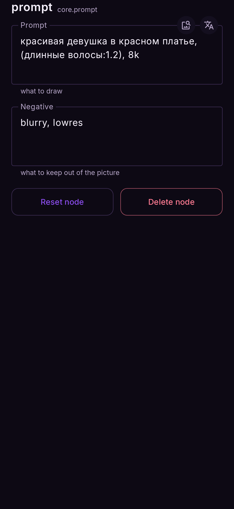
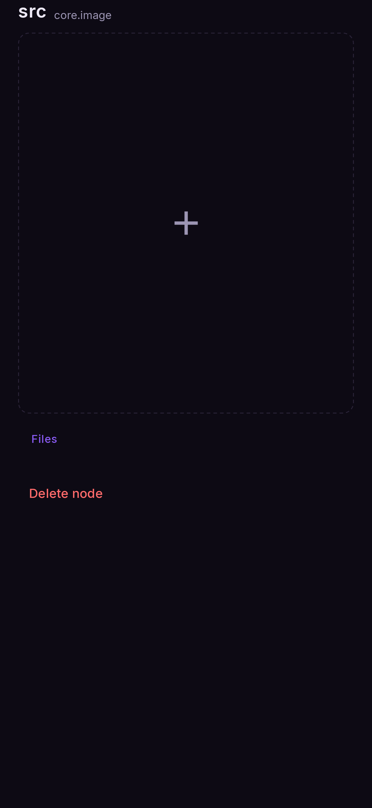

# Nodes and their settings

There are five kinds of node. Every flow, ready-made or yours, is built from these.

| node | palette tab | inputs | output |
|---|---|---|---|
| [Prompt](#prompt) | Common | - | prompt |
| [Image](#image) | Common | - | image |
| [Video](#video) | Common | - | video |
| [Image generator](#image-generator) | Generate | prompt, image (+ reference, + control) | image |
| [Inpaint generator](#inpaint-generator) | Inpaint | prompt, image | image |
| [Video generator](#video-generator) | Generate | prompt, image | video |
| [Wan video](#wan-video) | Generate | prompt, image | video, last frame |
| [Motion transfer](#motion-transfer) (Wan Fun Control) | Generate | prompt, image, control | video |
| [Output](#output) | Common | media | - |

Every node's sheet ends with **Reset node** (all settings back to default, and any batch sweep on
it released) and **Delete node**.
Double-tap a node's name in its sheet to rename it.

---

## Prompt

Holds the text. Both boxes are shown on the node itself; tap one to edit it.

| setting | what it does |
|---|---|
| **Prompt** | What to draw |
| **Negative** | What to keep out of the picture (ignored at CFG 1. FLUX.2, Z-Image, Qwen Image) |

A token count under each box tells you how much of the model's prompt limit you have used.
While you edit a box, a row of buttons under it works on the tag your cursor is in: **↑** and
**↓** make it heavier or lighter by 0.1 (written `(tag:1.1)`; back at 1.0 the brackets go),
**✕** deletes it, **+** starts a new tag after it, and the two arrows at the end undo and redo.
If the prompt is in **Russian or Chinese**, a **文A** button translates it to English on the
phone; the same button undoes it. See [Settings → Prompts → Translation](settings.md#translation). While you type, **tag autocomplete** offers matching tags under the box ([Settings → Prompts → Tag autocomplete](settings.md#tag-autocomplete)).

The **picture button** on the prompt box writes a prompt from a picture. Pick one already on the
canvas (an image node's photo, or what an output node made) or **From your phone**, and what to
write:

| | writes | for | model, time |
|---|---|---|---|
| **Short** | one sentence | photo models, SDXL, FLUX.2 | Florence-2 PromptGen, about 4 s |
| **Detailed** | a paragraph. Subject, clothes, pose, light, background | the same | Florence-2 PromptGen, about 4–5 s |
| **Tags** | Danbooru tags, the character if it knows them, and a rating | Illustrious, Anima, Pony | WD tagger, about 1 s |

It opens on **Tags** when the prompt feeds an anime checkpoint and on **Detailed** otherwise. An
empty prompt is filled straight away; otherwise you see the result and choose **Add after your
prompt** or **Replace your prompt**. Each model (548 MB and 378 MB) is offered the first time
you need it and listed in [Models → Tools](../models/manage.md). Sentences can get details wrong;
for anime, Tags is the accurate one. Nothing is filtered, and nothing leaves the phone.

<figure markdown>
  { .screen }
</figure>

## Image

A photo from your gallery. The empty node offers **Choose from photos**, which opens your phone's
**photo picker** (on a phone without one, your **Gallery** app, which may ask for the Photos and
videos permission), **Choose from files**, the file browser for a picture that is not in your
gallery, each with its **Add** button, and **Blank page** beside them to draw on. It appears on the node straight away, no Run needed. Once
there is a picture, a row of square buttons sits above it: **Photos** (another picture from the
picker), **Files**, **Draw** (paint over it, see Image to image) and the red bin (clear it), then
the file's name.

<figure markdown>
  { .screen }
</figure>

## Video

A video from the gallery (or **Files**), for [Motion transfer](#motion-transfer)'s **control**:
the motion your picture copies. It shows the video's first frame; which part of the video is used,
and how it is cropped, is chosen on the Motion transfer node.

## Image generator

The node that makes the picture. Its **title follows what is wired into it**:

| wired in | title |
|---|---|
| prompt only | *Text to image* |
| prompt + image | *Image to image*, or *Image edit* on FLUX.2 and Qwen Image |
| prompt + reference | *Image edit* (FLUX.2 and Qwen Image); on SD 1.5 Swap the title stays because the reference is IP-Adapter's picture |

The palette card is **Image** with a chip per family: **SD 1.5**, **SD 1.5 Swap**, **SDXL**,
**SDXL Swap**, **Anima**, **FLUX.2**, **Z-Image**, **Qwen Image**. The family decides which settings appear.

**Scheduler** (with its Schedule), **Seed** and **CFG** sit under **Scheduler, seed and CFG**, closed until you
open it; closed, it shows what they are set to (`Euler A · seed random · CFG 1.5`). The seed's padlock above Run
still locks the seed without opening it.

Hires fix (or Enlarge ×2), Match colours, Fix faces, Fix hands and Fix strength sit under **More options** at the end of
the node's settings. It opens and closes with a tap and remembers which; closed, it lists the ones that are on.

| setting | families | what it does |
|---|---|---|
| **Checkpoint** | all | The model. Switching family rewrites the node and keeps its wires. Keeping your steps, CFG and scheduler when asked also keeps the size, pulled inside what the new model can render (SD 1.5 and SDXL take their own sizes) |
| **Steps** | all | Refinement passes. Opens on the model's own recommended value |
| **CFG** | all | How strictly the prompt is followed. FLUX.2, Z-Image and Qwen are made for **1**: above 1 the negative prompt is read, but the picture burns quickly |
| **Seed** | all | `0` = a new picture every Run. Type a seed shown on a node to get that one back |
| **Scheduler** | all | The sampling method; a distilled model usually wants its author's choice. SD 1.5 / SDXL: DPM++ 2M, 2M SDE, 3M, 3M SDE, Euler, Euler A, LCM. DiT models: Euler (default), Euler A, Heun, DPM++ 2M, DPM++ 2M SDE, ER-SDE, Res Multistep, iPNDM, LCM. Anima: Euler, Euler A |
| **Hires fix** | SD 1.5, SDXL (not inpaint) | After the render, enlarge it ×2 with your first upscaler and redraw the detail with [UltraFix](results.md#ultrafix): one Run, a picture twice the size. Uses UltraFix's last Steps / Denoise steps. On the Snapdragon 8 Elite: SD 1.5 512 → 1024 about 16 s in all, SDXL 1024 → 2048 about 2½ min. Needs an upscaler: switching it on offers one to download, and so does a Run |
| **Enlarge ×2** | every Image node without Hires fix: FLUX.2, Z-Image, Qwen, Krea, Iris, Anima, the Swap models and every inpaint | After the render, enlarge it ×2 with your first upscaler, nothing redrawn. The node's own picture is the enlarged one, so wire it into an inpaint (with **Only masked**) to fix faces at the larger size. E.g. Z-Image text to image → enlarge → an inpaint over the face. Needs an upscaler: switching it on offers one to download, and so does a Run |
| **Fix faces**, **Fix hands** | every Image node but inpaint, Iris, Wan and Ideogram (on MOSS-Image since 1.6.222, new: please report) | After the render (and Hires fix or Enlarge), each face or hand is found and redrawn zoomed in, with this node's prompt and model, then blended back (ADetailer). A face or hand that already fills most of the picture is left as it is: redrawing it would only soften it. A Swap model redraws it with its LoRAs, without its ControlNet or reference picture. Up to 4 of each, the largest first. Needs the **Face and hand detector** from Models, Tools: switching it on offers it, and so does a Run. Each patch's tone is matched to the picture along its edge, so it leaves no lighter or darker ring. Each one found adds a render: on SD 1.5 about 2 s, more on bigger models |
| **Detection settings** | with Fix faces or Fix hands on | Opens a sheet with a Faces and a Hands tab, each showing your last picture with what the detector finds: solid boxes are fixed, dashed ones skipped. **Confidence** (0.30): lower finds small or blurred faces, higher skips things that only look like one. **Padding** (0.12): how far the redraw reaches past the box. **Mask blur**: how soft the patch's edge is. **Fix strength**: how much of a face (or hand) is redrawn, set apart from the other tab; it follows the node's Fix strength until you move it. Saved with the flow |
| **Fix strength** | with Fix faces or Fix hands on | How much of each face or hand is redrawn. 0.4 keeps the pose and fixes the detail |
| **Fix seed** | with Fix faces or Fix hands on | The seed of the fix. `0` = a new face or hand every Run, and a second padlock beside the picture's seed above Run. Lock the picture's seed, leave this one free and Run again: the picture is kept (not rendered again) and only the face is redrawn. Turning Fix faces on, or changing Fix strength, keeps the picture the same way. It cannot carry a face to another picture: the fix redraws the face that is there |
| **Variation seed**, **Variation strength** | SD 1.5, SDXL and Anima (not the DiT models yet) | A second seed mixed into the starting noise, as in the WebUI: a picture you like, nudged. Strength 0 is the seed alone; 0.05 to 0.3 keeps the picture and changes details; 1 is the variation seed alone. Under **More options** |
| **Match colours** | every Image node but Iris, Wan, MOSS and Ideogram | Image to image, inpaint and Fix faces / hands come back in the colours of the picture going in, so a redrawn patch has no tinted seam. Does nothing when nothing goes in and nothing is fixed |
| **Schedule** | SD 1.5, SDXL, the DiT models but Wan and Iris | How the noise steps are spaced: Normal, Karras or Exponential (not with LCM); the DiT models also have SGM Uniform, Bong Tangent, Simple and Beta. Normal is each model's own; on a 4- or 8-step DiT model the other two need about 12 steps |
| **Denoise** | with an image | How much of the photo is replaced. 0 keeps it, 1 replaces it. Image to image opens at 0.65, Image edit at 1.0 |
| **Resolution** | SD 1.5 | The sizes this model supports. A new size reloads the model on the next Run |
| **Aspect** | SDXL, Anima; FLUX.2, Z-Image, Qwen, Krea 2, Anima DiT | SDXL and Anima: crops the fixed 1024 square to that ratio. The others: sets Width and Height to that ratio. No reload |
| **Width**, **Height** | FLUX.2, Z-Image, Qwen | 512–2048 in 64-pixel steps. No reload |
| **LoRAs** | FLUX.2, Z-Image, Anima DiT, SD 1.5 Swap, SDXL Swap | Adapters on top of the model, each with a strength. [LoRAs](../models/loras.md) |
| **ControlNet** tile | SD 1.5 Swap, SDXL Swap | Type (**canny**, **depth**, **openpose** or none), strength, and the picture. Always an image node wired into **control**: switching a type on wires the node's own photo in (image to image) or adds an image node (text to image); **Replace** puts a different picture in its own node, **none** removes the wire. The node's own photo follows its **crop window**; any other picture has its own **Crop** (drawn over the photo, shaped like the render, zoomable out past its edges). An empty picture is skipped with a warning. Canny finds the edges; openpose finds the pose in a photo (the **Pose Detector**, 19 MB) or uses a skeleton as it is; depth makes a depth map from a photo (the **Depth Estimator**, 99 MB, about 1 s) or uses a ready-made one. Each ControlNet (SD 1.5 about 370 MB, SDXL about 1.3 GB, 8 Gen 3 and newer) and each estimator is a download offered on the tile and in Models → Tools; a ControlNet not yet built for your chip says so. On an SDXL Swap conversion made without ControlNet the tile is dimmed and says why: of the defaults, **Illustrious XL Swap** has ControlNet and IP-Adapter (a copy downloaded before 1.6.122 does not. Delete it and download it again) and **Juggernaut XL Swap** has LoRA only. The tile shows what the ControlNet sees; **⬇** above that picture saves it to the gallery |
| **IP-Adapter** tile | SD 1.5 Swap (npuforge 1.0.7+ and the defaults), SDXL Swap (npuforge 1.0.12+ with IP-Adapter ticked, and the Illustrious XL Swap default) | A reference picture the render follows: an image node wired into **reference**, added when you pick **plus** or **face** (**none** removes the wire), with its own **Crop** over the photo (shaped like the render; an empty picture is skipped with a warning). **plus** carries its subject and style, **face** a face; strength 0–1.5 (0.6 to start). The encoder (1.3 GB, about 6 s a picture) and each adapter (SDXL's 425 MB) are downloads offered on the tile and in Models → Tools. The tile shows the square the encoder reads. An older Swap model says to convert it again (or, for a default, to download it again) |
| **Crop** frame | with an image | Which part of the photo is used. Tap the picture on the node to frame it |
| **Pad** | with an image | What fills the frame where it runs off a small photo: **Black**, **Blur**; edit models also **Green** |
| **Allow padding** | FLUX.2, Qwen (edit) | Lets the frame zoom out past the photo; the padding is generated |
| **Reference** region | FLUX.2, Qwen, SD 1.5 Swap, SDXL Swap | Which part of the reference picture is used |

The **bars icon** beside Seed, Steps, CFG, Denoise and Scheduler arms that setting for a
[batch](../flows/batch.md).

## Inpaint generator

Everything the image generator has, plus the mask. Families: **SD 1.5**, **SD 1.5 Swap** (with its LoRAs and ControlNet; a blend inpaint, so a big fill can leave a soft seam), **SDXL**, **SDXL Swap** (with its LoRAs, ControlNet and IP-Adapter; a real inpainting model when converted with *Inpaint*), **Anima**, **Z-Image**, **Qwen Image** and **Krea 2** (the area is redrawn at the Denoise strength and blended back along the mask. Best at 0.5–0.8).

| setting | what it does |
|---|---|
| **Mask** | The area to repaint. [Inpaint](../flows/inpaint.md#the-mask-editor) |
| **Draw** | Paint colours and rough shapes inside the mask; the repaint follows them. It draws on the image node feeding the inpaint, the same layer as that node's own Draw |
| **Only masked** | *On (default):* work on a crop around the mask. More detail where you painted |
| **Stitch to original image** | *Off (default):* the result is the frame you chose. *On:* pasted back into the whole photo |
| **Grow** | Widen or narrow a tapped or picked area |
| **Feather** | Soften the mask's edge |
| **Enable tap to select** | Tap an object in the mask editor to select it (Segment Anything, 87 MB) |
| **Enable auto mask** | Pick Clothes, Face, Hair, Shoes or Bag by name (29 MB); the flow remembers it |
| **Enable Add Objects** | Paste objects from another photo and repaint only their edges. [Add Objects](../flows/add-objects.md) |
| **Pad** | Black, Blur or Green, for frames that run past the photo (outpainting) |

The three *Enable* boxes remember how you last left them: a new Inpaint node starts the same way.

## Video generator

The text- and image-to-video model. Needs the video models (Models → Video).

| setting | what it does |
|---|---|
| **Seed** | `0` = a new clip every Run |
| **Upscale** | *On (default):* 2× to 1024 × 640. *Off:* 512 × 320, a little faster |
| **Crop** frame | With a photo wired in: which part is animated |

## Wan video

Wan 2.2: text or a photo to a clip of up to 5 seconds. Needs Wan 2.2 (Models → Video).

| setting | what it does |
|---|---|
| **Seed** | `0` = a new clip every Run |
| **Seconds** | 1 to 5, 24 frames a second |
| **LoRAs** | Wan 2.2 5B LoRAs (not 14B), chosen like on the image nodes; `<lora:name>` tags in the prompt work too |
| **Width**, **Height** | Any shape in 32 px steps, up to 1280 × 704 worth of pixels (832 × 480 by default; 1280 × 704 takes about three times as long) |
| **Crop** | With a photo wired in: tap the preview, then drag the frame to choose which part becomes the first frame |
| **Model** | A dropdown: Wan 2.2 Turbo, Neodragon (the fastest), or Wan 2.2 14B with a picture wired; the node becomes that model's node and back |

Its **last frame** output is the clip's final frame as a picture: wire it into another Wan video
node's **image** to continue the clip with a new prompt. That node's **video** is then the whole
film so far, both clips joined ([longer clips](../flows/video.md#longer-clips-one-film)).

## Motion transfer

Wan 2.2 Fun Control: the picture wired into **image** moving like the video wired into
**control** (a [Video](#video) node). Needs Wan 2.2 Fun Control (Models → Video).

| setting | what it does |
|---|---|
| **Seed** | `0` = a new clip every Run |
| **Width**, **Height** | As on Wan video |
| **Mode** | Pose or As is: how the video becomes the motion. The ⓘ says which to use when ([Motion transfer](../flows/video.md#motion-transfer)) |
| **Crop** | Which part of your picture is used, as on Wan video |
| **Video** | Tap the preview. Two handles choose the part of the video that drives the clip; its length is the clip's (up to 5 s). A box on that part's first frame, at the clip's shape, cuts every frame the same way |

It has no **Seconds** (the part of the video sets the length) and takes no LoRAs.

## Output

Where the result lands. It shows the picture or clip; tap it to see it full screen. Its finishing steps sit under **Post-processing** at the end of its settings, folded until you open it (closed, its header names the ones switched on). There are three cards, **Upscale**, **Colour correction** and **Adjust colours**, each with:

- **After every Run**: a switch that applies the step to every new picture.
- A button. **Correct** applies colour correction to the last picture right now. **Upscale** and **Adjust** open a window with that step's settings (the upscaler and scale, or the four sliders) and a button that applies it to the last picture. Nothing is rendered again and no seed is locked: the flow reruns on that picture's own seeds, so only the Output works.
- Under the name, what Upscale and Adjust colours are set to (for example *Anime 4x · 4x*), so the settings in the window are never out of sight.

| setting | what it does |
|---|---|
| **Autosave** | *On (default):* every Run is kept in Results with the flow that made it |
| **Upscale** | Enlarge the result before keeping it. The node then shows what it received above what it made. Greyed out on an output wired a video: a clip cannot be upscaled |
| **Colour correction** | Fixes a dull or tinted picture: darks darker, brights brighter, a colour cast removed, after any upscale. A warm scene stays warm |
| **Adjust colours** | **Brightness**, **Contrast**, **Saturation** and **Warmth** sliders (each -1 to 1, 0 unchanged) in its window, after Colour correction |
| **Upscaler** | In the Upscale window: which upscaler to use. Install them under Models → Upscalers |
| **Scale** | In the Upscale window: 2×, 3× or 4×. A result that would pass 4096 px gets the largest scale that fits |
| **Save** (video) | Also write the MP4 to `Movies/Nightmare` |
