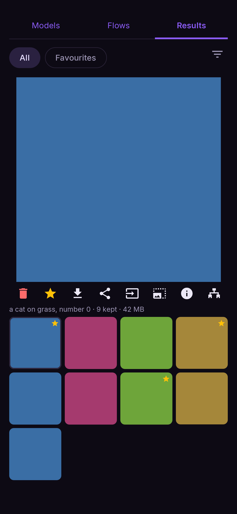
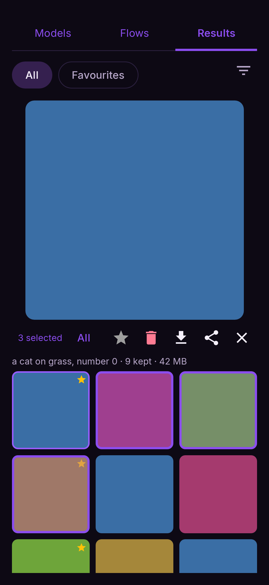

# Results

**Results** (top of the screen) holds everything you have made, newest first. Each picture is
kept **together with the flow that made it**: prompt, model, seed, every setting, so you can
always get back to exactly how it was made.

<figure markdown>
  { .screen }
</figure>

## Browsing

- **All** / **Favourites** switch between everything and the pictures you starred. The filter
  icon narrows the list further.
- A [batch](../flows/batch.md) is kept as one group: its pictures are shown together under one
  card.
- Tap a picture to show it large; tap the large one to see it full screen (pinch or double-tap
  to zoom; a video clip zooms the same way while it plays).
- The arrow above the grid **folds** the large picture away so the grid fills the screen (or
  drag it up; drag down to bring it back). Folded, a tap on a picture opens it full screen.

## The picture's buttons

| button | does |
|---|---|
| 🗑 **Delete** | Removes it (asks first) |
| ★ **Favourite** | Stars it; starred pictures appear under **Favourites** |
| ⬇ **Save to gallery** | Writes a copy to your phone's gallery |
| **Share** | Shares the picture with another app |
| **Send to a flow** | Offers the flows that take a photo: Image to image, Inpaint, Image edit, Upscale, Image to video, and opens the one you pick with this picture in it |
| **Upscale** | Enlarges it with an upscaler; the bigger copy is kept as a new item. The same window offers **UltraFix**: see below |
| ⓘ **What made this** | The prompt, model, seed and settings, and a way to use them on the open flow; on a DiT picture, **Diagnose**: see below |
| **Open flow** / share the flow | Reopens the flow that made it on the canvas, or shares that flow as a file |

A clip plays on its card; tap it to play it full screen. A [chain of clips](../flows/video.md#longer-clips-one-film)
is kept as the whole film plus every part, each with the picture it started from, in one group.

## Use a picture's prompt, seed or the picture itself

In **ⓘ What made this**, the rows you can reuse are tinted: the **picture**, its **prompt**, its
**negative** and its **seed**.

1. **Long-press** one to select it, then tap any others you want.
2. Tap **Use** (it shows how many you picked).
3. For each one, pick the node of the flow that is open now that should get it. Only nodes that
   can take it are offered, each with a line of what it holds now; when only one can, it is
   already picked. **Skip** leaves one out. The picture can also go to a **New image node**.
4. With a prompt or negative among them, tick **Add to the end of the prompt** to keep what the
   node already says; otherwise it is replaced.
5. **Use.** The canvas opens with the changed nodes selected. A copied seed is **locked**, so the
   next Run reproduces it; unlock it on the run bar to go back to random.

## Diagnose a picture that came out wrong

On a picture from a DiT model (FLUX.2, Z-Image, Qwen, Krea 2, Anima, Iris, MOSS, Ideogram),
**ⓘ What made this** also offers **Diagnose**. Use it when a model makes broken pictures on your
phone (blown colours, grain, stripes) that it does not make elsewhere.

1. Tap **Diagnose**, read the note and tap **Diagnose** again.
2. The app renders the same picture again, with its own settings and seed, up to 17 times. Each
   time one part of the work moves off the NPU. Keep the app open: it takes about 17 times as long
   as the picture did.
3. Every picture lands in Results as one group, each labelled with what was moved. A report opens
   at the end that says which ones came out different from the first.
4. Find the one that looks right, and send the report with its label to the developer. That names
   the part of the NPU to fix on your chip.

## Selecting several

Long-press a picture to start selecting, then tap more. Save, share and delete then act on all
of them. The ✕ stops selecting.

<figure markdown>
  { .screen }
</figure>

## UltraFix

Upscaling makes a picture bigger, not more detailed. **UltraFix** (from Local Dream) redraws the fine
detail of an upscaled picture tile by tile while keeping its composition, and keeps the result as a
new item. Open it from the **Upscale** window on a picture whose shorter side is at least 512 px
(1024 px for an SDXL model), so upscale a render first. To do both on every Run, turn on
**Hires fix** on the Image node ([nodes](nodes.md)).

| setting | default | what it does |
|---|---|---|
| **Steps** | 10 | The schedule UltraFix runs on |
| **Denoise steps** | 4 | How many of those steps actually redraw. More changes more |
| **Denoise with "masterpiece, best quality, 4k resolution"** | on | Off uses the picture's own prompt |

It uses the picture's own model when that is an SD 1.5 or SDXL model on your phone, otherwise the
one selected. Every tile runs every step, so larger pictures take longer. A 1024² picture took
about 11 s on a Snapdragon 8 Elite.
